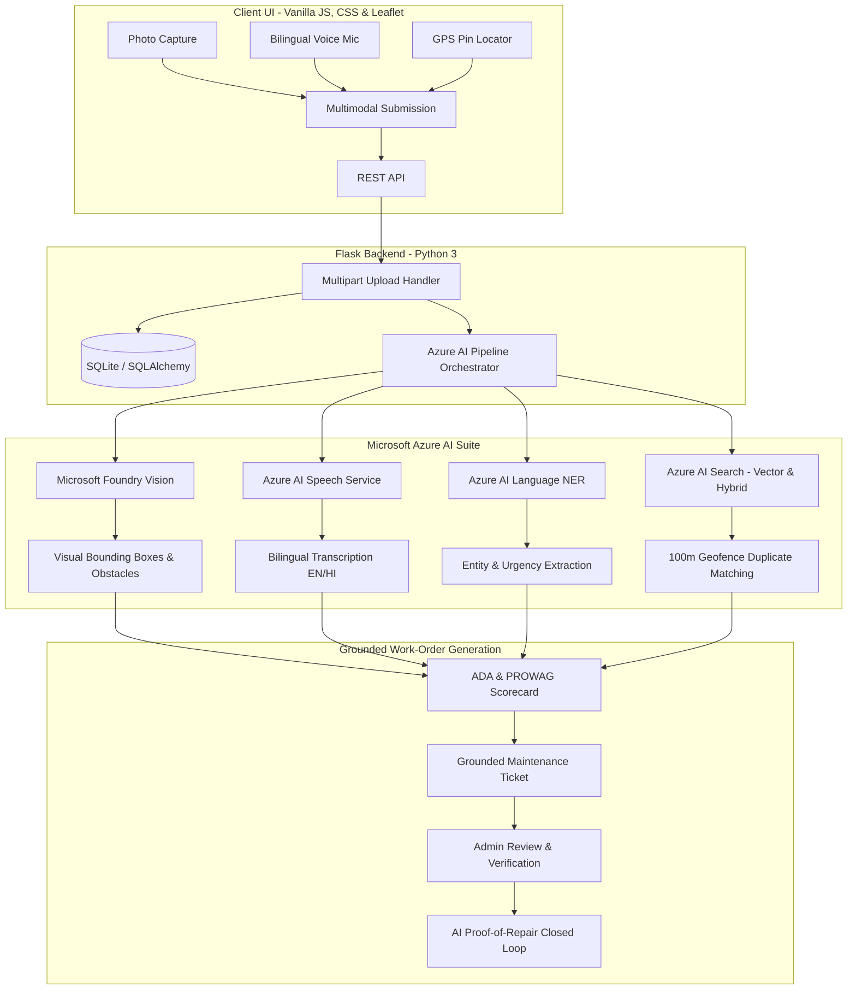

# AccessPulse AI Platform – Multimodal Accessibility Auditor

[](https://python.org)
[](https://flask.palletsprojects.com/)
[](https://azure.microsoft.com/)
[](https://leafletjs.com/)
[](https://www.ada.gov/)
[](LICENSE)

> **An enterprise-grade, multimodal accessibility auditing platform for public infrastructure, university campuses, and municipal wards.**  
> Powered by Microsoft Foundry Vision, Azure AI Speech, Azure AI Language, and Azure AI Search with automated ADA compliance scorecards, visual bounding boxes, duplicate geofencing, and closed-loop "Proof-of-Repair" AI verification.

---

## 📌 Problem Statement

Public spaces, transport terminals, and university campuses frequently present severe physical accessibility barriers—such as blocked curb ramps, broken footpaths, stepped entrances lacking ramps, and missing tactile/Braille directional signage. 

Citizens and mobility-impaired individuals face substantial friction when attempting to document, report, and track these barriers:
- Existing reporting forms are text-only and cumbersome to use on the go.
- Maintenance tickets lack grounded visual evidence, exact coordinates, or disability impact assessments.
- Municipal agencies receive hundreds of redundant duplicate reports for the same obstruction.
- Work orders often stall without structured verification or accountability.

---

## 💡 What AccessPulse AI Does

**AccessPulse AI** combines computer vision, bilingual voice processing, semantic NLP, and vector retrieval into one end-to-end civic issue management system:

```
  Citizen Intake (Photo + Audio)
               │
               ▼
  ┌─────────────────────────────────────────────────────────────┐
  │              Azure Multimodal AI Pipeline                   │
  │                                                             │
  │  1. Microsoft Foundry Vision    ──▶ Obstacle Bounding Boxes │
  │  2. Azure Speech (EN & HI)      ──▶ Bilingual Transcript   │
  │  3. Azure AI Language           ──▶ Conversational NER     │
  │  4. Azure AI Search             ──▶ 100m Vector Geofence    │
  │  5. Grounded Work-Order Engine  ──▶ Facility Dispatch Ticket│
  └─────────────────────────────────────────────────────────────┘
               │
               ▼
  Facility Admin Review & Rerouting
               │
               ▼
  Field Crew Repair + AI "Proof-of-Repair" Verification (Resolved)
```

---

## 🚀 Key Features

### 1. Multimodal Intake (Photo + Voice in English & Hindi)
- **Drag-and-Drop Image Capture**: High-resolution upload of curb ramps, damaged sidewalks, stepped entrances, or missing signage.
- **Bilingual Voice Narration**: Voice recording using HTML5 Web Audio API with a **live frequency waveform visualizer** on canvas.
- **Language Switcher**: Native support for **Indian English (`en-IN`)** and **Hindi (`hi-IN`)**.
- **Interactive Pin Locator**: Draggable Leaflet marker with 1-click browser GPS geolocation.
- **⚡ 1-Click Quick Scenarios**: Instant presets for Blocked Ramp, Cracked Pavement, Inaccessible Steps, and Missing Braille Signage.

### 2. Microsoft Foundry Vision Models (Multimodal Grounding)
- **Object Detection & Visual Grounding**: Identifies construction material, broken pavement tiles, tripping hazards, and missing truncated domes.
- **Visual Bounding Boxes**: Draws interactive bounding boxes with confidence scores and violation tags directly over the user's photograph.
- **Accessibility Impact Assessment**: Evaluates specific harms for wheelchair users, visually impaired individuals, and mobility-aid pedestrians.

### 3. Azure AI Speech & Azure AI Language
- **Multilingual Speech-to-Text**: Converts Hindi and English audio into accurate text narratives.
- **Conversational NER & Text Analytics**: Extracts structured entities (category, location landmark, severity score, urgency level, user sentiment, and impacted disability cohorts).

### 4. Azure AI Search (Hybrid Semantic + Vector Retrieval)
- **100-Meter Geofenced Duplicate Detection**: Evaluates incoming reports against the spatial database using hybrid vector similarity and geofence distance filtering.
- **Prevents Redundant Work-Orders**: Flags duplicate community reports with exact similarity percentages and distance in meters.

### 5. ADA & PROWAG Accessibility Compliance Scorecard
Every reported issue is automatically evaluated against official standards:
- **ADA 405.2**: Ramp slope grade limits (Max 8.33% / 1:12 slope).
- **ADA 403.5.1**: Continuous clear pathway width (Minimum 36 in / 915 mm).
- **ADA 705.1**: Detectable warning surfaces (truncated domes).
- **PROWAG R302.3**: Continuous firm, stable, and slip-resistant surface.

### 6. Dynamic Accessible Detour Routing
- Identifies safe, ADA-compliant detour paths around reported barriers and calculates detour distances (e.g. *"Rerouted via South Arcade Ramp – 85m alternate route"*).

### 7. Closed-Loop AI "Proof-of-Repair" Verification
- When field crews complete a repair, admins upload a resolution photo.
- The vision model re-analyzes the scene, confirms **0 obstacles remaining**, and verifies ADA compliance restoration before closing the ticket.
- Renders a **side-by-side Before vs. After comparison** in the audit log.

### 8. GIS Dashboard & Municipal Exports
- **Interactive GIS Map**: Modeled after professional GIS accessibility audit interfaces, featuring condition polylines, sub-tabs (`Accessibility`, `Run Slope`, `Cross Slope`, `Clear Width`, `Deterioration`), and `Cluster Items` toggling.
- **Half-Donut Accessibility Gauge**: Semicircular canvas gauge showing the campus audit score (e.g. **3.8 / 5.0**).
- **Ramp Grade Distribution Bar**: Multi-segment horizontal bar displaying all 6 deterioration levels with pill-shaped legends.
- **1-Click GeoJSON Export**: Exports the entire asset catalog as an OGC-compliant GeoJSON `FeatureCollection` ready for Esri ArcGIS, QGIS, or city portals.

---

## 🏗️ System Architecture



---

## 📂 Project Structure

```
AccessPulse-AI-Platform/
├── app.py                  # Flask application & Azure AI pipeline endpoints
├── requirements.txt        # Python package dependencies
├── .gitignore              # Git ignore configuration
├── README.md               # Detailed project documentation
├── static/
│   ├── index.html          # SPA shell with GIS sidebar & topbar tabs
│   ├── styles.css          # Full GIS styling, gauge canvas & bounding box overlays
│   └── app.js              # SPA router, Leaflet map, audio recorder & AI renderer
└── uploads/
    └── images/             # Uploaded audit photographs & generated sample assets
        ├── sample_ramp.jpg
        ├── sample_footpath.jpg
        ├── sample_entrance.jpg
        └── sample_signage.jpg
```

---

## 🛠️ Installation & Quickstart

### Prerequisites
- Python 3.10+
- Modern Web Browser (Chrome, Edge, Firefox, Safari)

### 1. Clone the Repository
```bash
git clone https://github.com/Swayam26-rwt/AccessPulse-AI-Platform.git
cd AccessPulse-AI-Platform
```

### 2. Create and Activate Virtual Environment
```bash
python3 -m venv venv
source venv/bin/activate  # On Windows: venv\Scripts\activate
```

### 3. Install Dependencies
```bash
pip install -r requirements.txt
```

### 4. Run the Platform
```bash
python3 app.py
```

The application will start on **http://localhost:5001** with 28 seeded realistic accessibility audit reports across Indian campus landmarks (IIT Delhi, AIIMS, JNU, Connaught Place).

---

## 📡 REST API Reference

| Method | Endpoint | Description |
|---|---|---|
| `GET` | `/` | Serves the main GIS Single-Page Application |
| `GET` | `/api/dashboard/stats` | Returns aggregate metrics, 12-week trends, and severity distributions |
| `POST` | `/api/reports` | Multipart form submission (image, voice, category, location, lat, lng, language) |
| `GET` | `/api/reports` | List reports with `?category=`, `?status=`, and `?search=` filters |
| `GET` | `/api/reports/<id>` | Retrieves detailed single report metadata and analysis |
| `POST` | `/api/reports/<id>/analyze` | Triggers the multimodal AI analysis pipeline |
| `PUT` | `/api/reports/<id>/status` | Administrative approval, rejection, or status update |
| `POST` | `/api/reports/<id>/verify-repair` | Submits resolution proof photo for automated AI verification |
| `GET` | `/api/reports/geojson` | Exports all audited assets as an OGC GeoJSON `FeatureCollection` |
| `GET` | `/api/reports/<id>/similar` | Spatial search for similar assets within a 500m radius |

---

## 🌟 What Makes AccessPulse AI Distinctive

1. **Multimodal Native**: Unifies vision understanding, speech processing, and spatial GIS in one cohesive loop.
2. **Bilingual Accessibility**: Full English and Hindi voice support for inclusive citizen engagement.
3. **Standards Grounded**: Evaluates real ADA 405.2 / 403.5 and PROWAG R302.3 engineering criteria rather than vague descriptions.
4. **Closed-Loop Accountability**: AI-powered "Proof-of-Repair" verification ensures tickets cannot be marked resolved without visual validation.
5. **Municipal Ready**: 1-click GeoJSON export integrates directly into municipal GIS planning software.

---

## 📄 License

This project is licensed under the MIT License — see the [LICENSE](LICENSE) file for details.
